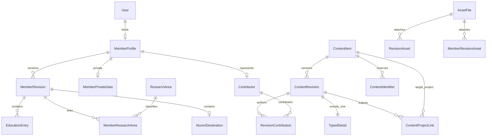

# V4 数据模型与事务约束

## 模块边界

- accounts：保留现有User/角色/Session与AuthAuditLog，User主键和历史迁移不变。
- members：成员档案、私有联系方式、版本化教育/方向/去向、申请容器与资产引用。
- content：稳定成果身份、类型明细版本、唯一标识、贡献者、项目/资产关联。
- workflow：共享版本状态和仅追加用途的BusinessAuditLog；V4无审批API。
- assets：私有默认资产元数据；V4无上传下载路由。

## 字段与权威来源

稳定业务对象与版本使用UUID，不替换已有User的整数主键。业务表内部辅助关系使用默认BigAutoField。ContentItem.kind限定八类且创建后不可变（防止已建立项目入边失效），创建者/最后编辑者与时间位于身份表；ContentRevision有递增number、标题摘要、状态、编辑者、提交时间和base_published_revision。

PAPER/PROJECT/AWARD/ACTIVITY/NEWS/BLOG/PUBLICATION/LAB_PAGE各对应一张独立明细表，字段见 [V4 spec](../specs/V4-统一成员资料与科研内容数据库.md)。明细以revision为一对一主键，不把全部类型装入JSON。项目经费内部默认不出现在安全展示投影中。

Contributor可链接一个MemberProfile，也可仅有外部姓名/单位。RevisionContribution保存职责、顺序、通信作者标记与署名/单位快照；正式成员改名不改历史署名。AUTHOR顺序同版本唯一，同人不同职责可存在但同版本/人/职责唯一。关系附着revision而非实时ContentItem，避免待审版本污染公开作者。

MemberProfile.membership_status为内部资格，MemberRevision.member_kind/public_member_status为审核后的公开身份；都不等于User.role。公开隐私门以public_visible/contact_visible/education_visible/alumni_visible四个布尔字段实现，不使用任意JSON。只有公开指针与对应门均允许才投影字段；账号邮箱/电话/管理备注不进入公开serializer。

教育/去向在版本上，未勾选is_public的数据不公开。原件路径仅AssetFile内部storage_key，V4接口不返回路径或未经授权文件URL。全局ResearchArea规范词创建后不可改名，纠正词项需建立新词并以新版本审核替换关系，避免历史快照被间接改写。MemberSlug保留跨版本URL占位；MembershipApplication仅建立状态/目标/证明/审核人容器，V5才开放审批。

## PostgreSQL约束

普通Unique/Check覆盖版本号、活动稿唯一、账号一对一、职责排序、日期顺序、成员/申请状态、类型枚举和唯一标识。DOI去前缀空白并小写，项目号去空白大写，ISBN去连字符空白且校验checksum；ContentIdentifier以(scheme,value)唯一、引用稳定item，不能因新草稿清空旧标识而创建重复成果。

延迟constraint trigger在事务提交时检查：每个内容版本必须且只能有一个匹配类型明细；发布/工作指针必须属于本对象且状态正确；基线版本同对象；关联项目必须PROJECT且非自身；贡献职责符合类型；明细的标识必须有本对象规范化占位。允许同事务先建revision再建detail，不允许半套数据提交。Identifier保留值不可直接重分配给别的对象。

BEFORE trigger保护非DRAFT版本及其明细/署名/关联/教育等快照，拒绝插入、修改、删除其子行；账号删除导致edited_by置null不修改内容快照。后续审批可仅按明确状态转换修改state，不能顺便改正文。子表检查锁定父版本，防止并发发布与写子表交错。

延迟图约束锁定稳定对象，使并发关系校验不基于过时图。业务服务也按actor→对象→版本顺序加锁；用户/对象权限在写事务里重查，不信任早先认证快照。lock_version避免两个标签最后写入覆盖。

## 服务与审计

members.services提供本人草稿初始化/复制/更新、管理者建立未绑定档案和内部绑定原语；绑定无HTTP端点，不能改角色或自动认领重名。content.services提供受控创建草稿与贡献关系，CUSTOMER不能借内部服务获得投稿权；学生须有效ACTIVE成员，ROOT/ADMIN/TEACHER按既有业务管理权限。无发布、审批或批量导入API。

BusinessAuditLog只记录actor及快照ID、目标UUID、版本、动作、结果、字段名和请求UUID；资料值、密码、Token和完整正文不写日志。成功写入与审计同事务，审计失败回滚资料；API对数据库故障返回脱敏503。

## 迁移与扩展

assets/members/content/workflow各有initial迁移，content与members另有图约束SQL迁移。成员图约束依赖content图约束中的共享不可变函数；逆迁移按Django依赖顺序先解除成员触发器。生产回退默认保留新表，绝不为了退应用逆迁移删除成员/成果。

V5继续建立编辑授权、追加确认事件、审核决策和身份申请流程；V6公开API/旧资料迁移与受控文件；V7 AI只能生成候选。V4不提前实现它们。

## V5 增量（2026-11-06）

新增 8 张业务表：ContentEditGrant、RevisionEditEvent、RevisionSubmission、ReviewDecision、ContributionConfirmation、CorrectionRequest、MemberPublicationConsent、ContentModerationEvent。记录协作权、实际编辑、提交、审批、署名确认、纠错、公开授权和管理理由；核心历史追加不可改。原 V4 27 张业务表扩展为 35 张，不改变自定义 User 和四种业务 role。

MemberProfile 增加 privacy_version；MemberRevision 增加 base_published_revision；MembershipApplication 增加 statement、review_note、lock_version；Contributor 增加可空 created_by。9 个新增迁移位于 content/members/workflow，包含 V4 编辑历史与成员草稿发布基线回填，不改原快照字段或伪造批准。ROOT/ADMIN 私密成员审批按目标账号保护；实际编辑者元数据不被审核动作覆盖。私有文件使用新增 private_media 卷，不存数据库文件或公网媒体目录。详见 [工作流](workflow.md) 和 [V5 验收](V5-验收报告.md)。

## V6 增量

新增 ImportBatch、ImportRecord、LegacyURLMap 三张表，记录清单哈希、管理者、逐条源哈希/载荷摘要/结果/目标，以及规范旧路径到内容或成员的唯一映射。跨来源别名碰撞拒绝，不按姓名认领；同批次幂等，源变更保留历史并建立候选稿。

AssetFile 增加 purpose、deletion_requested_at，区分证明与可公开候选附件。三项迁移为 assets/0002、0003 与 content/0004。0003 回填已有头像用途，并只提升当前公开已批准的清洁头像可见性；证明不公开。既有 User/角色/审核历史不变。公共 API 使用集中 public_selectors 和显式投影，所有公开读取 no-store，未加入搜索集群、共享缓存或 AI 模块。

## V7–V9 增量

V7新增AIImportJob、AIConsent、AICandidate、AIUsageLedger、AIQuotaBucket五张表，ai_assistant/0001、0002记录租约、授权文本摘要、候选/应用指针、已发送标记、计费预留/实结/UNKNOWN及核账理由摘要；assets/0004只扩展ai_source用途，不修改已发布内容。候选最多10条逐条应用，原业务版本与公开指针仍由原服务控制。

V8使用原成果/成员/审核表ORM聚合，不另建事实库。V9无业务模型变更，增加服务器运行角色分权；迁移服务保留服务器管理员身份，backend/worker运行角色无superuser/CREATEDB/CREATEROLE。旧User及角色枚举不变。

## V10增量

ContentItem新增visibility_scope（PUBLIC/TEAM）与featured，公开读取同时校验范围、撤下和归档门禁。ContentRevision/MemberRevision仍为不可变历史，直接保存创建新生效快照；新迁移保留旧审核/确认/申请记录。MemberRevision支持CUSTOMER但其资料不进入公开选择器；Resume保存本人私有求职意向/简介和resume用途文件引用。旧ADMIN受控归并为TEACHER并审计，所有账号刷新Session版本；Teacher业务编辑与Root账号安全管理分离。contact为新增受控LAB_PAGE键，home布局由前端代码固定。
