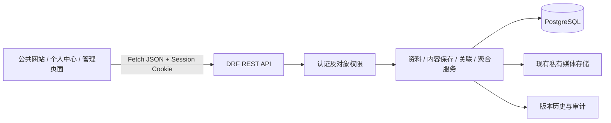

# V10：蓝色科技官网与简化协同架构改造

状态：**待用户评审；本轮仅编写计划，尚未实施。**  
开发分支：`arc-update`；代码审查基线：`0904f9a`；编写日期：2026-11-06。  
执行位置：`/opt/Lab_web`；遵循 `AGENTS.md`，批准后仍在当前项目开发，不另建开发副本。

## 1. 改造目标与范围

将当前偏重“投稿—确认—审核—发布”的实验室平台，调整为“结构化填写—直接保存—自动展示”的科研团队网站。沿用原生 HTML/CSS/JavaScript、Fetch、Django REST Framework、Django ORM 和 PostgreSQL，不重建 Django 项目，不引入前端框架、构建工具、微服务或第二套数据源。

目标为：蓝色科技视觉、统一公共模板、固定首页框架、API 聚合、三种用户身份、Root 独立安全管理、直接编辑生效、成员成果统一关联。以主要功能顺畅为先，性能压测和精细生产环境验收另行安排，不重复上一阶段的长时间验证。

本计划获批后，新的权限与直接保存规则替代 V2/V5/V6.1 中冲突的日常管理、审核与自审规则；旧版本仍作为历史记录保留。Session、CSRF、密码哈希、审计、版本历史、并发冲突检测、文件安全、隐私隔离继续保留。

**本轮不修改业务代码、不生成或执行数据库迁移、不安装依赖、不运行写入型验证、不部署、不清理历史数据。** 已有用户改动 `deploy/docker/backend.Dockerfile` 和未跟踪 `README.md` 不属于本计划修改。

## 2. 当前实现与主要差异

本节依据仓库文件静态审查，不代表本轮检查过生产数据库或重新执行过测试。

| 范围 | 已有实现 | 需要调整的问题 |
| --- | --- | --- |
| 架构 | `backend/config/urls.py` 统一挂载 `/api/`；前端已有 Fetch 客户端；PostgreSQL 为业务数据源 | 已基本前后端分离，重点是接口及页面组织，不另建系统 |
| 认证 | `accounts.User`、Session/CSRF、登录限流、密码修改、独立 `is_superuser` | 当前 ADMIN/TEACHER 可以管理普通账号角色、密码及启停，与新规则冲突 |
| 用户名 | `accounts/serializers.py` 使用 `UnicodeUsernameValidator` | 代码实际上允许中文用户名；新增账号需明确新的登录名规则，不能假定当前已经禁止中文 |
| 成员 | `MemberProfile` 绑定账号；`MemberRevision` 保存姓名、简介、头像；教育、研究方向、毕业去向有结构表 | 资料类型只有 STUDENT/TEACHER，Customer 缺少独立清晰的个人资料及求职简历入口；资料类型与账号权限可能不一致 |
| 内容 | `ContentItem`、`ContentRevision`、八类详情、项目关联、统一标识去重 | 保存工作稿与公开快照分离，普通保存不会自动更新公开页面 |
| 成果关联 | `Contributor` 可绑定成员或为外部贡献者；`RevisionContribution` 有排序、姓名快照及确认状态 | 新增关联必须选已注册 Teacher/Student，不能再手填外部贡献者或要求确认 |
| 流程 | `workflow` 提交、审核、贡献确认、授权、审计、归档、撤下齐全 | 需要取消普通审核链，但保留授权、审计和历史，不应只隐藏审核按钮 |
| 数据库约束 | 成员/内容图约束、已提交快照不可变、状态迁移触发器、公开日期派生触发器 | 直接保存必须适配数据库状态约束，不能绕开 ORM 或全局关闭触发器 |
| 公共展示 | `/api/public/content/`、成员/成果/项目产出/旧 URL 解析；共享公开选择器 | 可复用，但首页 `index.html` 仍按 `LAB_PAGE home` 内容渲染，没有固定多模块聚合首页 |
| 导航与视觉 | `data/navbar-unified.html`、`navbar-loader.js`；全局已有蓝色变量 | 原导航为九栏目平铺、Logo 居中；页面布局分散，Footer 与面包屑缺少统一约定 |
| 表单 | 现有内容编辑、成员申请、附件上传及业务客户端 | 用户仍要接触版本、贡献确认、用途等概念；表单需按业务场景简化 |
| AI | 私有文档提取、授权、候选、人工应用和费用控制 | 保留能力，候选应用需接入新权限与表单，不能借 AI 绕开账号授权或自动公开简历 |
| 统计 | `analytics` 公共、个人、内部统计与 CSV | 数据源可复用；审核时长等旧流程指标应退出当前看板，不能伪造为零 |
| 测试 | accounts/members/content/workflow/assets/AI/analytics 测试，浏览器认证/公开页/流程/AI/统计测试 | 旧测试中的“必须提交审核”“Teacher 能重置他人密码”等预期必须按批准的新规则改写 |

审查入口包括上述模型、服务、迁移 SQL、路由、序列化器，以及 `frontend/js/content-editor.js`、`member-profile.js`、`public-page.js` 和现有测试/接口文档。既有验收数量只属于上一版本，不作为 V10 已通过的证据。

## 3. 架构与模块责任



- 公共网站、个人中心和管理区使用适合各自任务的模板，共享设计变量、Header/Footer 和 API 客户端。
- 前端负责展示、交互、输入提示、上传状态及作者排序；不直接访问数据库，不把隐藏按钮当权限控制。
- 后端负责身份、对象范围、字段白名单、文件权限、保存事务、去重、关联有效性、隐私过滤和聚合口径。
- PostgreSQL 继续保存唯一业务事实；首页、个人主页和科研栏目不复制论文/项目数据。
- 继续同域 `/api/` 和现有系统 Nginx；前后端分离不等于必须拆成跨域部署。继续回环 `127.0.0.1:8000`，数据库不开放宿主公网端口。
- 复用 `accounts`、`members`、`content`、`workflow`、`assets`、`analytics`；首页聚合放在 `content`，无需新增首页业务数据库或通用页面搭建器。

## 4. 身份、权限与安全边界

### 4.1 推荐映射：复用角色字段，不叠加第二套权限等级

| 内部业务权限名 | 用户看到的身份 | 数据库存储建议 | 范围 |
| --- | --- | --- | --- |
| Root | 系统管理员，仅管理区显示 | `is_superuser=True` | 全部业务及系统、用户、安全信息管理 |
| Admin | Teacher | `role=TEACHER` | 自己、其他 Teacher、Student 的业务资料；全部团队内容 |
| Team | Student | `role=STUDENT` | 自己的资料；自己创建或被明确授权编辑的团队内容 |
| Custom | Customer | `role=CUSTOMER` | 自己的个人资料及私有求职简历 |

Admin/Team/Custom 是能力分组名称，不再新增一套可独立修改的等级字段。旧 `role=ADMIN` 在受控数据迁移后归并为 TEACHER；兼容期识别旧值但采用新能力边界，过渡结束后从新建/修改枚举中移除。Root 不进入普通 role 枚举，`is_staff` 仅用于 Django 管理站点访问，不随业务身份自动赋值。

### 4.2 对象与字段权限矩阵

| 操作 | Root | Teacher | Student | Customer |
| --- | --- | --- | --- | --- |
| 修改本人密码/登录联系信息 | 可以 | 可以 | 可以 | 可以 |
| 创建账号、授予身份、禁用账号、重置他人密码 | 可以 | 不可以 | 不可以 | 不可以 |
| 修改本人业务资料 | 可以 | 可以 | 可以 | 可以，仅本人私有范围 |
| 修改其他 Teacher/Student 业务资料 | 可以 | 可以，不含安全信息 | 不可以 | 不可以 |
| 查看或修改其他 Customer 私有资料/简历 | 可以，记录访问/修改审计 | 不可以 | 不可以 | 不可以 |
| 创建团队内容 | 可以 | 可以 | 可以 | 不可以 |
| 修改团队内容 | 全部 | 全部 | 本人创建或有效编辑授权 | 不可以 |
| 给其他人授予内容编辑权 | 全部 | 团队内容范围 | 不可以扩散授权 | 不可以 |
| 修改首页布局/模块顺序 | 不通过业务表单开放 | 不开放 | 不开放 | 不开放 |

Teacher 能编辑业务字段不代表能读取 `MemberPrivateData` 的管理备注、求职文件、私有电话或登录邮箱；这些字段默认仅本人/Root。Teacher 不得替他人扩大公开范围；可以修正已授权公开的业务内容，新增公开范围仍由本人或 Root 明确操作。Teacher 不能借编辑资料修改账号角色、用户绑定、密码、`is_active`、`is_staff`、`is_superuser` 或 Session 状态。

账号安全 API 统一仅 Root 管理他人；Teacher 不再拥有旧账号列表的管理能力。Student 的“成果关联人”身份不自动产生编辑授权，`ContentEditorGrant` 继续承担编辑授权。授权对象必须为有效 Teacher/Student，Customer 即使残留旧授权也不得写公共内容。Root 身份优先于其普通 role 值判定。

每次写入在事务内重新核验当前账号状态、角色、目标和可写字段，覆盖降权、禁用与授权撤销的竞态。前端从 `/api/auth/me/` 和 capabilities 读取可用能力，不自行拼接 role 决定服务端权限。

### 4.3 姓名与登录名

- 账号登录名与中文姓名分离：登录名用于认证；`MemberRevision.display_name` 作为业务姓名唯一展示来源，`first_name/last_name` 仅兼容旧数据，不长期双向维护两份姓名。
- 新注册登录名建议限制为 ASCII 字母、数字及 `._@+-`，长度沿用现有上限；新注册默认为 Customer，注册请求不能设置角色。
- 已有中文登录名保留可登录，不强制重命名，不改变账号主键；新规则只约束新建或主动改名。姓名回填先取现有 display_name，再取旧姓名字段，均为空则提示完善，不能用 username 代替公开姓名。
- 首次进入作者选择或公开成员资料前，姓名是该业务记录成立所必需的字段。缺姓名账号可保留身份，在团队目录显示“姓名待完善”，暂不能被新增为作者，补齐后可选。
- 同名账号通过选填的院系/年级等上下文区分，选项实际绑定稳定 ID；不泄露邮箱、手机号，不把用户名拼成作者姓名。

## 5. 取消审核后的直接保存机制

### 5.1 日常操作

普通页面只保留“保存”“取消”“查看历史”，内容另有“公开展示/仅团队可见”可见性选择；不再出现提交审核、审核意见、贡献确认、待我审批等流程。有效 Teacher/Student 的有权限编辑在保存成功后立即成为当前版本，无需上级操作。

- 用于官网展示的团队论文、项目、竞赛、新闻等新内容默认 **PUBLIC（公开）**，保存按钮附近明确提示；Teacher/Student 可在保存前改为 **TEAM（团队内可见）**，两者均不要求审批。TEAM 只对有效 Teacher/Student/Root 可读，不对 Customer 开放。“团队目录默认互见”不等于将目录或私有资料公开。
- 成员资料具有本人公开开关和字段隐私选项；对公开字段的编辑保存后立即更新，对私有字段的修改不会使其公开。
- Customer 的资料和简历始终 PRIVATE，本轮不提供其公共主页或公开简历开关。Root 授予团队身份也不自动公开旧简历或私人字段。
- 有 PUBLIC 旧版本的内容，编辑后直接替换公开快照；改为 TEAM、撤下或归档时，匿名列表、详情、聚合、搜索及附件下载立即收紧。

### 5.2 保留版本，移除审批依赖

复用现有稳定对象、不可变 revision、乐观锁和历史指针：一次保存创建新的完整快照，在同一事务中校验业务字段/作者/文件，更新当前指针，追加编辑及审计记录。已经保存的历史快照仍不可原地篡改。

推荐继续使用既有 `published_revision` 表示已生效快照以减少公共接口改造；它是否对匿名可见由 PUBLIC/TEAM/PRIVATE 门禁决定，不能仅凭该字段名判断公开。Customer 个人资料保留私有当前版本；需要扩展现有成员资料类型约束支持 CUSTOMER，并在公开选择器强制排除 Customer。

实施时为内容增加明确 `visibility_scope`，与归档/紧急撤下门禁分别建模；历史内容根据现有公开状态回填为 PUBLIC 或保守的 TEAM。公开选择器必须同时满足生效快照、PUBLIC、未撤下/归档等条件。现有 `public_sort_date` 继续从生效快照派生，不新增独立首页日期来源。

当前冻结触发器不允许从 DRAFT 直接变为 PUBLISHED；需新增迁移调整内容/成员的状态转换约束，允许受控“新快照直接生效”，保留已保存快照不可变、外键图一致性、唯一当前版本、唯一作者位置等约束。**不能通过关闭所有数据库触发器，也不能后台伪造一次提交/审核通过来实现直接保存。**

恢复历史时，按当前权限校验后将选中历史复制为一个新版本，不移动回旧指针、删除后续历史或复活已撤回的隐私授权。历史作者已降级/解绑时需提示修正，历史附件必须重新检查可用性，不能绕过新规则恢复。

### 5.3 兼容旧流程

旧 `ReviewDecision`、`RevisionSubmission`、确认及申请记录保留只读。新界面不读取它们作为可编辑或生效的前置条件。

旧提交、审核、确认、身份申请接口在切换后返回明确的停用响应（建议 410 与稳定错误码），不再继续修改数据；身份请求改为提示联系 Root 授权。旧审核链接进入流程调整说明或只读历史页，不静默执行新的“保存”。

未处理的 DRAFT/SUBMITTED/APPROVED/REJECTED 等工作版本不得迁移时自动公开：记录旧状态，保留旧快照；编辑者可将其载入新表单并主动保存，旧生效版本在此之前不变。取消审核不等于批量发布历史草稿。

## 6. 统一数据模型与成果关联

### 6.1 复用与最小新增

| 数据 | 方案 |
| --- | --- |
| 用户与身份 | 复用 User 和主键；归并旧 ADMIN；Root 单独管理身份 |
| 各身份业务资料 | 复用 MemberProfile/MemberRevision、教育、方向、毕业去向；支持 Customer 私有资料，身份字段由账号派生，不接受前端自由指定 |
| 论文/项目/竞赛 | 复用 PAPER/PROJECT/AWARD typed detail、ContentIdentifier、项目关联与贡献关系，不新建平行成果库 |
| 新闻/活动/技术文章 | 复用 NEWS/ACTIVITY/BLOG；旧内容保留类型与 ID |
| 资源共享 | 先复用 BLOG 的受控 RESOURCE 分类与附件，服务端定义分类映射；不为简单下载页新增通用资源系统 |
| 联系我们 | 扩展 LAB_PAGE 的受控 contact 页面键，并同步更新 PAGE 标识校验、约束和迁移工具；保留 about，不允许借页面内容编辑首页布局 |
| 求职简历 | members 中新增最小 Resume 模型：本人归属、标题、选填求职意向/自述、私有文件引用、版本/修改时间；个人经历引用既有资料，避免再复制一套论文库，不做招聘/投递系统 |
| 编辑权和历史 | 复用 ContentEditorGrant、BusinessAuditLog、RevisionEditEvent、revisions；不新增通用权限引擎 |

`MemberProfile.user` 仍唯一绑定账号，历史无账号档案继续保存，但不会作为新增关联候选。成员的 Teacher/Student/Customer 身份必须以 User 为准，不把 `member_kind`、教师档案、毕业状态或旧申请批准当成隐式提权入口。

### 6.2 账号关联与排序

1. 提供仅 Teacher/Student/Root 可访问的可关联成员目录，默认这些身份相互可见；匿名和 Customer 不可枚举团队私有目录。
2. 返回最小字段：账号稳定 ID、资料 ID、姓名、Teacher/Student 身份、选填院系/年级；不返回 username、密码、登录邮箱、电话、简历或系统权限标记。
3. 新关联只接受有效、已注册、姓名完整的 Teacher/Student 账号 ID。后端在保存时再次校验，拒绝伪造 Customer、禁用账号、无账号 Contributor、重复作者或不存在账号。
4. 前端为可搜索下拉、多选标签和“上移/下移”排序，不要求手填贡献者姓名、UUID 或排序数字。
5. 有显式排序时，按用户提交的完整账号 ID 序列归一为 1..N；未指定排序时，沿用已有作者相对顺序，新增作者按稳定账号 ID 排序。首次未排序全部按稳定 ID 排序，结果可复现且不受请求乱序影响。
6. Contributor 与 MemberProfile 绑定复用，新增作者时按账号找到唯一 Contributor；一条 ContentItem 关联多个作者，个人主页按同一 item ID 投影，不能为每位作者复制一篇论文。
7. 新记录不再要求 contribution confirmation；原确认历史保留。作者关联只建立成果关系，不授予编辑权，不改变被关联账号的公开选项。

团队内部使用当前业务姓名。新模式的公共作者姓名也从当前获准公开的资料投影，姓名修改后关联页面自动更新；版本历史继续保存当时姓名快照。目标成员未允许公开姓名时，公共成果可显示不含身份链接的“团队成员”，不返回内部账号 ID/真实姓名。不能把“团队默认互见”扩大为“全网可见”。

旧未绑定、外部作者的名字留在历史版本和已存在的公共署名快照，不删除或按同名自动绑定；重新编辑这类内容时标为历史署名，允许保留历史快照，但不能将其伪装为可新增的团队账号关联。Root 可根据明确账号选择完成绑定，迁移不得凭姓名猜测。

### 6.3 自动传播示例

Student 在有权编辑的论文表单选择多位团队作者并保存：后端一次保存 item/revision/detail/author links → 返回同一个 item ID → 本人及已关联成员的成果接口按关系读取 → 科研栏目读取同一生效快照 → 首页聚合读取同一公开选择器。

TEAM 内容只更新团队内部视图；PUBLIC 内容才进入匿名官网与公共统计。成员本人隐私收紧、账号降为 Customer 或被禁用时，相关目录和个人主页立即收紧；不删除共同成果或其他作者的关联。降权者保留历史署名事实，但停止新增关联和编辑，公共姓名按隐私规则处理。

## 7. 表单、上传与便捷编辑

### 7.1 表单组织及最小必填

个人中心按“基本资料 / 教育经历 / 科研项目 / 论文 / 竞赛成果 / 简历”分组；Teacher 管理区复用同一业务表单编辑有权管理的目标资料，账号安全管理单独放 Root 页面。

| 场景 | 必填 | 其他字段 |
| --- | --- | --- |
| 注册 | 登录名、密码及前端确认密码 | 姓名/邮箱选填，不增加身份审批材料 |
| 公开成员或成果关联 | 姓名 | 头像、简介、教育、研究方向、联系方式等选填 |
| 论文/项目/竞赛/资源 | 标题、系统确定的类型 | DOI、编号、日期、期刊、资助、级别、奖项、附件等选填；论文可不填作者，若填作者则必须有效 |
| 新闻/活动/文章 | 标题 | 正文、图片、地点、时间等选填，不填写则不展示空标题区 |
| 新增教育行 | 学校 | 专业、学历、起止时间选填；全空行忽略，不强制至少一条 |
| 简历 | 用于区分的标题，可提供可编辑默认值 | 意向、自述、附件等选填；仅本人/Root可访问 |

必填项用红色 `*` 并提供文本说明；其余字段统一标注“选填”。红色只用于必填、错误、危险操作等语义，不作为主背景色。前后端采用同一字段规则，空字符串、null 和空数组规范化；可选字段留空不影响保存，已填写的 DOI/邮箱/日期仍做合法性验证。空字段不渲染空标签、“None”“null”或无意义占位卡片；统计的真实零值必须正常显示，不能误当空字段隐藏。

### 7.2 上传

用户流程固定为“选择文件 → 上传 → 保存”，呈现文件名、大小、状态、预览/替换/移除。业务场景决定用途和可见性，asset ID、purpose、版本号仅在客户端状态/API中传递，不显示为输入框。

复用上传、受控下载、安全解析和清理，新增 resume 用途；私有原件不放进静态目录。后端验证文件所有者、目标使用权、用途、类型、大小和安全状态。Teacher 编辑他人有权管理的业务资料时，仅能上传并绑定当前业务需要的头像/公共附件，不能借目标 ID 上传或下载他人私有简历。

未完成上传不能保存引用；失败保留表单输入；替换成功前保留旧文件，保存失败不会删除正在使用的文件。取消或未绑定上传由现有到期清理处理，不在用户操作中暴露清理细节。

### 7.3 AI 的位置

保留为表单中的可选“从文档辅助填写”，不另要求用户编辑原始 JSON、UUID、用途代码、版本号。前端将候选映射到当前结构化表单，用户核对后点击正常“保存”。应用候选本身不立即公开；公共生效仍由用户明确保存并选择可见性。

AI 继续显式授权、脱敏、费用上限和私有文件策略；姓名匹配只作为提示，最终作者必须由账号下拉选择并经服务端校验。Customer 只能辅助本人资料/简历，不能借 AI 创建团队内容。没有启用 AI 时可完整手工填写；本轮计划不授权新的付费调用或改变既有预算。

## 8. 导航、页面与视觉设计

参考站点：[华中科技大学官网](https://www.hust.edu.cn/)。本次查看其公开首页，参考对象为顶部人群快捷入口、多层栏目导航、图文重点区和分区信息组织；不复制其品牌、图片、文案或主色。以下蓝色方案是本项目设计，不是对参考站配色的复刻。

### 8.1 四层导航

| 层级 | 内容与交互 |
| --- | --- |
| 顶部快捷栏 | 团队成员入口、资源入口、搜索、登录/注册；登录后个人中心/退出；管理能力入口按 API 显示 |
| 品牌与一级导航 | 实验室Logo/名称 + 八个一级栏目；Logo链接首页，不再把九个条目分列Logo两侧 |
| 二级菜单 | 桌面鼠标/焦点展开，触屏点击展开；支持键盘、Escape关闭，不能只依赖hover |
| 页内导航 | 首页 > 一级栏目 > 分类/详情；当前位置、页面标题和可选同级侧栏保持一致 |

| 一级栏目 | 二级栏目/数据来源 |
| --- | --- |
| 首页 | 固定模块聚合，不提供内容块自由编辑 |
| 团队概况 | 团队简介、研究方向；about 与 ResearchArea |
| 团队成员 | Teacher、Student、毕业成员；公开成员与去向 |
| 科学研究 | 科研项目、发表论文、出版成果；PROJECT/PAPER/PUBLICATION |
| 竞赛成果 | 学科竞赛、荣誉奖励；AWARD 按 category 分类 |
| 新闻动态 | 团队新闻、学术活动、团队活动；NEWS/ACTIVITY，必要分类复用 |
| 资源共享 | 技术文章、学习资料、公开下载；BLOG/RESOURCE 分类及安全附件 |
| 联系我们 | contact 受控内容；仅公开联系信息，不自动读取账号邮箱 |

### 8.2 全站视觉规范

- 色板建议：深蓝 `#08264A`、科技蓝 `#176BCE`、浅蓝 `#EAF3FF`、白色 `#FFFFFF`、正文 `#172B4D`。将颜色、间距、圆角、阴影、字体和断点集中为设计变量；错误文字颜色与白底保证对比。
- 首页深蓝 Banner 使用 CSS 渐变/轻量 SVG 网格与科研关键词；固定品牌标题、简介和“科研成果/了解团队”入口，不用大型粒子库。标题与布局属于前端代码，统计和精选卡片来自 API。
- 正文最大宽度约 1200–1280px；统一模块标题、更多链接、日期、标签和图片比例；大图重点内容配小卡片/列表，避免每个栏目都堆满图卡。
- 列表页统一标题区、筛选、分页、空态/错误/重试；详情页统一面包屑、标题、元信息、正文、作者、关联项目和附件；成员页为姓名/简介/成果分区。
- Footer 共享团队名称、受控联系信息、栏目链接及必要备案信息；不存在的字段不造假填充。Header/Footer 由受控静态片段及共享加载器实现，不引入自由HTML编辑。
- 公共页采用展示模板；个人中心采用侧栏/分组表单；管理区采用目标列表+同一编辑组件；三个区域风格一致但不强行复用同一种页面布局。
- 建议断点：桌面≥1024px、平板768–1023px、手机<768px；手机抽屉导航、单列卡片、作者标签换行、可触达的保存按钮。至少覆盖1440/768/390/320宽度，不依靠全局 `overflow-x:hidden` 掩盖布局溢出。
- 尊重减少动态效果偏好，表单label、焦点、错误定位和键盘操作完整；装饰图与空图片区域不挤占主要内容。

### 8.3 首页固定框架

顺序建议：快捷栏与导航 → 科技 Banner → 团队概况/研究方向 → 最新新闻（重点图文+列表）→ 科研成果（论文/项目切换）→ 竞赛成果 → 团队成员精选 → 动态统计 → 资源入口 → Footer。

模块无公开数据时显示简洁空态或收起该模块，不回退到写死的示例记录；背景装饰不算业务内容。精选成员和内容由“置顶优先、业务日期降序、稳定ID”规则选择，可在原业务对象上增加最小精选/置顶字段，仅 Teacher/Root 可设置；不建立首页专用内容副本。没有精选项时自动取最新公开项，数量由服务端固定上限控制。

## 9. 首页聚合 API 与一致展示

新增 `GET /api/public/home/`，复用公开选择器和 analytics 口径，推荐返回结构：

```json
{
  "schema_version": "v10.1",
  "as_of": "<服务端时间>",
  "stats": {"members": 0, "papers": 0, "projects": 0, "competitions": 0},
  "research_areas": [],
  "news": [],
  "papers": [],
  "projects": [],
  "competitions": [],
  "members": [],
  "resources": []
}
```

该示例中的零/空数组仅说明空库响应形状，不是前端硬编码数据。卡片使用已有公共字段子集：稳定 ID、标题/姓名、可选摘要/日期/封面、站内详情地址；不返回原始HTML、内部修订、私有资产路径和账号字段。接口不返回任意布局代码、模块HTML或可执行脚本。

统计定义：成员为当前允许公开的 Teacher/Student 档案；论文/项目为当前 PUBLIC、未撤下/归档的唯一 item；竞赛为 AWARD.category=COMPETITION，荣誉不混计。项目历史结项仍可计入“累计项目”，在文案注明累计口径。共同成果全站计一次，个人参与数可重复，不能把各成员计数相加当全站总量。

初版不做跨请求聚合缓存，保持公开变更下一次请求可见；前端保存后刷新相关区域，其他已打开页面在刷新/重新进入时更新，不承诺无刷新实时推送。匿名页面不得短暂展示团队数据再用JS隐藏。

使用统一聚合服务获得有界数据；统计及卡片应采用一致数据库读取快照或等效一致读取策略，避免同次响应统计与卡片因并发变更互相矛盾。未知日期用明确稳定回退排序，但不虚构业务日期；空字段不展示。首页故障显示重试和正常导航，不用示例数据伪装成功。

## 10. 接口调整清单（拟定契约，实施前固定）

所有路径均以 `/api/` 为基准；沿用Session/CSRF，写请求先获取 Cookie，携带轮换后的 `X-CSRFToken`。返回对象只读字段与服务端可写字段分离。

| 接口 | 处理方式 |
| --- | --- |
| `auth/register/`、`login/`、`logout/`、`csrf/`、`change-password/` | 复用；注册仅Customer，新增登录名规则兼容历史登录 |
| `auth/me/` | 复用/扩展：返回展示身份、业务姓名、capabilities；自身账号响应与团队目录投影分开 |
| `admin/users/`、`{id}/`、`{id}/reset-password/` | 保留路径，所有他人账号管理统一Root限定，Teacher旧调用必须被后端拒绝 |
| `members/me/profile/` GET/PATCH | 新增统一本人业务资料接口，适配Customer/Student/Teacher；当前draft接口短期只读兼容或明确停用写入 |
| `members/{id}/profile/` GET/PATCH | 新增管理目标业务资料接口，Root/Teacher按矩阵校验；拒绝安全字段及越权Customer |
| `members/directory/` GET | 新增内部团队下拉目录，最小字段，搜索/分页/角色过滤受控 |
| `members/me/resumes/`、`{id}/` GET/POST/PATCH | 新增最小私有简历管理；对象级校验，不提供匿名下载或公共检索；Root通过独立 `admin/members/{id}/resumes/` 受审计入口管理，Teacher不能访问 |
| `content/items/` POST、`content/items/{id}/` GET/PATCH | 复用路径并升级契约：一次传完整结构表单并直接保存生效，含可见性与账号作者序列；不再要求逐项调用贡献创建/确认 |
| `content/items/{id}/history/` GET | 复用历史查询，展示修改人姓名、时间、改动摘要，不暴露隐私正文给无权限者 |
| `content/items/{id}/restore/` POST、成员对应history/restore | 新增恢复为新版本，权限/文件/关联/隐私重新校验 |
| `content/items/{id}/grants/` | 复用，仅Root/Teacher管理编辑授权；关联作者不隐式授权 |
| `content/capabilities/`、`content/projects/` | 复用，改为新权限；项目候选也按PUBLIC/TEAM可读范围过滤 |
| `assets/`、受控download/delete、`public/assets/{id}/` | 复用并增加场景与绑定校验、resume用途；公开下载必须重查当前公开门禁 |
| `public/home/` GET | 新增固定首页聚合 |
| `public/content/`、`public/members/`、成员achievements、项目outputs | 复用，更新新公开边界、当前姓名和统一卡片字段；不得给匿名目录暴露私有姓名 |
| `public/pages/about/`、`public/pages/contact/` | about复用、contact扩展；home旧页面键保留兼容但不作为布局来源 |
| `public/stats/*`、`stats/me/`、管理统计/CSV | 复用统计口径，适配新可见性；审核指标改为历史视图或明确“不再适用”，不强行混入新编辑统计 |
| `ai/*` | 路径保留，复用预算/授权；候选人工填表，按新身份及可见性保存，不自动公开 |
| `*/submit/`、审核decision、contribution confirm、成员申请写接口 | 切换后停用写入，返回410；历史数据保留，不继续日常审批 |
| `public/legacy/` 和旧静态URL | 保留解析与既有映射，旧栏目进入新栏目/详情，不能回退到旧静态隐私原件 |

并发版本由响应 ETag/前端状态持有并通过 `If-Match` 或兼容锁字段提交；初版可复用 `lock_version`，但页面不展示。冲突返回409并保留用户输入，提示重新读取/比较后保存，不静默覆盖。输入错误400、权限403或不可枚举对象404、停用流程410；文件错误和事务失败返回明确可恢复状态。

## 11. 角色与历史数据迁移方案

以下为获批后执行设计，本轮不连接生产库实施。

1. **盘点与只读报告**：实际数据库migration状态、各角色账号、Root标记、用户—档案—Contributor绑定、重复/空姓名、旧中文用户名、未处理工作版本、未绑定外部作者、私有文件、旧授权和公开门禁；输出受控清单，不写入Git。
2. **一致备份与演练**：复用既有DB+媒体备份和隔离恢复工具；先在隔离副本验证迁移，不覆盖生产。
3. **扩展兼容schema**：新增可见性、最小简历、Customer资料类型、contact受控键及必要约束；保留原表/ID/slug/标识/历史，迁移可重复检测，不手改已提交的历史迁移文件。
4. **先部署新权限检查再做角色归并**：所有非Root先失去账号安全管理能力；旧ADMIN按新Teacher能力临时兼容，之后映射为TEACHER。记录前后角色映射，不把任何账号自动变Root。
5. **资料身份对齐**：User作为授权来源；旧资料类型不自动决定角色。显示类型不一致列入报告，新增版本对齐，不修改不可变历史。Root授予Teacher/Student时确保一对一档案，默认不扩大公开隐私。
6. **可见性回填**：原允许公开且已有生效快照的数据继续PUBLIC；未公开数据保守TEAM，Customer为PRIVATE；归档/撤下不被角色迁移解除。TEAM不等于允许所有Customer访问。
7. **旧稿与关联兼容**：工作稿保留、未审不自动生效；历史外部署名保留；禁止按姓名猜绑定。旧授权针对Customer/禁用者失效，保留历史记录以便追溯。
8. **会话刷新与切换**：角色/权限语义变化账号递增session_version，要求重新登录；部署前后都执行Root/Teacher/Student/Customer的拒绝用例，避免旧Session仍具有旧管理权。
9. **核对**：账号主键及密码哈希未变、Root未丢失、内容/文件/审计历史未删除；原公开对象仍可按旧链接访问，未公开对象无意外曝光；异常映射需Root明确处理后再完成切换。

若实际运行镜像/数据库尚未包含仓库中V7–V9最新迁移，应先在隔离副本补齐已存在迁移再验证V10升级；不能根据Git分支名判断数据库已升级。数据迁移脚本提供dry-run、apply及受控映射记录，真实值不提交文档。

## 12. 拟修改与新增文件

最终按批准契约细化，不为目录整洁而大规模搬迁原有代码。

| 文件/目录 | 主要工作 |
| --- | --- |
| `backend/apps/accounts/{permissions,services,serializers,views}.py` | Root独占安全管理、新身份映射、登录名规则、capabilities及会话失效 |
| `backend/apps/accounts/models.py`、新增migrations | ADMIN兼容迁移及角色约束收敛，保留is_superuser独立 |
| `backend/apps/members/{models,permissions,services,serializers,views,urls}.py` | Customer私有资料、目标业务编辑、目录、简历、姓名投影、历史恢复 |
| `backend/apps/content/models/{base,contributors,details}.py`、新增migrations | 可见性/精选字段、账号关联、contact与状态约束调整 |
| `backend/apps/content/{services,serializers,public_selectors,public_serializers,public_views,public_urls}.py` | 保存及公共投影，复用现有统一内容服务 |
| 新增 `backend/apps/content/home.py`（或同等小模块） | 首页聚合服务及序列化，不新增首页内容副本 |
| `backend/apps/workflow/{permissions,api,content_services,member_services,serializers,member_serializers,views,urls}.py` | 路由实际在此：移除审批依赖，复用授权/审计/历史，旧写接口明确停用 |
| accounts/members/content新增migrations；必要的workflow兼容迁移 | 新约束和直接快照状态，不删除审批历史表 |
| `backend/apps/assets/{models,services,views,public_views}.py`、必要migration | resume用途、业务目标绑定与公开/私有下载边界 |
| `backend/apps/ai_assistant/{services,schemas,tasks,serializers,views}.py` | 新权限和表单应用，停用旧draft假设，保持预算/隐私逻辑 |
| `backend/apps/analytics/{metrics,views}.py` | 新可见性与成员口径、历史审核指标标注 |
| `frontend/data/navbar-unified.html`、`frontend/js/navbar-loader.js` | 快捷栏、八栏导航、下拉、登录状态与统一壳层 |
| 新增 `frontend/data/footer-unified.html`、`frontend/js/layout.js` | 共享Footer/面包屑与初始化，复用导航加载而非并建第二个Header |
| `frontend/css/{style,public,auth,workspace,ai-import,statistics}.css` | 统一蓝色设计变量、布局、组件、表单及响应式 |
| `frontend/index.html`、新增 `frontend/js/home.js` | 固定首页骨架和聚合渲染，移除首页任意正文布局入口 |
| `frontend/{about,member,content,profile,workspace,content-editor,member-application,ai-import,statistics,login,register}.html` | 展示/填写/认证模板统一；成员申请页改资料入口或兼容说明 |
| `frontend/manage/`、`frontend/js/{management,review,member-profile,content-editor,workspace}.js` | 简化团队管理、Root安全区、直接保存，旧review页面只读/说明 |
| `frontend/js/{auth,content-api,public-api,assets,public-page,member-profile-public,member-papers,content-list,statistics,ai-import}.js` | 共享请求与错误、姓名渲染、表单/上传/关联、新公开字段 |
| `frontend/data/`现有九类栏目及旧深层入口 | 对应新导航分类、共享模板与旧URL兼容；不批量删除旧数据文件 |
| 拟新增 `frontend/contact.html`、`resources.html`、`resume.html`（必要时） | 联系/资源聚合/私有简历界面，不重复建成果页 |
| `backend/apps/*/tests/`、`tests/browser/` | 更新被新需求明确替代的预期，新增关键权限/保存/关联/聚合回归 |
| `docs/{auth-api,member-api,content-api,public-api,workflow,ai-import,stats-api,data-model,admin-guide}.md` | 更新契约、角色矩阵、直接保存及兼容说明；补首页API说明 |

Nginx、Compose、Dockerfile原则上无需为视觉和业务简化而变动；只有新增静态路由确实需要时才单独列出最小差异，不能顺便覆盖用户配置。真实 `.env`、数据库和文件资产不纳入Git提交。

## 13. 执行阶段与依赖

| 阶段 | 工作与产物 | 前置条件/退出标准 |
| --- | --- | --- |
| A：契约冻结 | 确认本计划、角色矩阵、默认PUBLIC团队内容及可选TEAM可见性、姓名/旧稿兼容；形成接口字段表与页面草图 | 用户批准本spec；不提前改代码 |
| B：权限及兼容底座 | 新账号/对象权限、角色与资料迁移脚本、目录、会话失效 | 旧Teacher安全管理被拒绝、Root可用；隔离迁移保留数据 |
| C：直接保存与资料 | 事务快照、约束、业务表单API、上传、简历、历史恢复、作者下拉及授权 | 同一成果单条存储，多成员关联正确；Customer全程私有 |
| D：视觉壳层与核心页面 | 先完成Header/Footer、首页骨架、资料页、内容编辑页，再套用列表/详情模板 | 使用C阶段真实API；无示例硬编码统计；手机可操作 |
| E：聚合及整站接入 | home API、成员主页、科研/竞赛/新闻/资源、统计、AI候选填表与旧链接 | 保存后下一次读取各页同步；隐私与姓名规则一致 |
| F：必要验收与交付 | 关键后端回归、少量真实浏览器主链、迁移核对、文件清单、实际结果和部署步骤 | 无已知权限漏洞/数据丢失；未验证项明确列出；不自动部署 |

B、C建立稳定后再接D/E；视觉壳层草图可与B并行，但不能先做大量依赖旧审核接口的页面。每个阶段以一条可操作业务链交付，不再逐个功能开展长时间压测或反复扩展测试范围。阶段F统一检查，发现关键失败先修复。

## 14. 功能测试与验收标准

本轮仅列未来命令和预期，**以下命令本轮均未执行**，不将计划写成已通过。优先复用现有隔离helper（暂沿用stage=v7名称，含义是独立测试环境，不代表只测V7）：

```bash
LAB_TEST_STAGE=v7 python3 tests/support/v4_environment.py up
LAB_TEST_STAGE=v7 python3 tests/support/v4_environment.py manage check
LAB_TEST_STAGE=v7 python3 tests/support/v4_environment.py manage makemigrations --check --dry-run
LAB_TEST_STAGE=v7 python3 tests/support/v4_environment.py manage migrate --noinput
LAB_TEST_STAGE=v7 python3 tests/support/v4_environment.py manage migrate --check
LAB_TEST_STAGE=v7 python3 tests/support/v4_environment.py manage test --verbosity 1
# 实施时新增的关键浏览器主链文件，非现有已运行文件：
LAB_TEST_STAGE=v7 python3 tests/support/v4_environment.py browser /tmp/lab-web-v3-venv/bin/python 'test_v10_browser.py'
LAB_TEST_STAGE=v7 python3 tests/support/v4_environment.py down
```

不在生产数据库执行自动化测试或造数；helper测试镜像、独立数据库/卷和AI假密钥隔离继续有效。未来升级验证以现有已验证helper方式扩展V10迁移演练，而非直接覆盖生产。

### 必须覆盖的关键断言

1. 注册只能Customer；登录Session、CSRF及自身密码修改有效；新登录名规则与旧中文账号兼容。
2. Teacher编辑其他Teacher/Student业务资料成功；编辑Customer、改他人密码/角色/启停、扩大他人隐私失败；伪造API字段同样失败。
3. Student编辑本人/自建或获授权内容成功；他人资料及未授权内容拒绝；仅被列为作者不自动可编辑。
4. Customer只能编辑本人资料/简历，无法写团队内容或读取内部团队目录；简历ID猜测、匿名下载、跨Customer访问均拒绝。
5. 一次保存即生效，无提交/审批/确认；姓名、关联、文件、历史及当前指针同事务提交，失败无半保存；并发冲突返回409，保留表单输入。
6. 作者候选只包含有效Teacher/Student；后端拒绝伪造Customer/外部无账号作者；显式排序与默认排序稳定；界面显示业务姓名而非username。
7. 同一论文关联两名成员，只生成一个item；两个个人主页、科研列表与首页统计正确；TEAM不进入匿名网站，PUBLIC下一次请求可见。
8. 资料改名后各新展示读到当前获准公开姓名，历史快照仍可追溯；隐私收紧、降权、禁用不会泄露内部目录、姓名、附件或简历。
9. 原公开URL和详情继续可用；未审草稿不因迁移自动发布；旧审批写接口停用；恢复历史产生新版本且不恢复过期隐私授权。
10. 选填为空仍能保存且页面不出现空字段；已填错误日期/标识拒绝；上传只有文件选择/状态/保存，原安全和权限断言继续有效。
11. 首页统计来自API，空库展示真实零/空态；新建/修改/撤下内容后重新读取联动，服务器异常不回退假数据。
12. 浏览器以少量主链验证注册登录、资料保存、多作者论文、公开页更新、Customer私有简历、Teacher越权拒绝；桌面和手机抽查导航/表单/详情即可，本次不要求全浏览器/真机矩阵或10分钟压测。

被本次需求替代的旧审核/Teacher安全管理测试，改为验证新规则及历史只读兼容，并在交付记录注明变更理由。与新规则无冲突的安全断言保留；不能通过删除测试、跳过失败或硬编码结果完成验收。交付准确记录通过/失败/跳过及未验证项目，不再沿用197/42等旧版本数量。

## 15. 风险、兼容与回滚

| 风险 | 控制措施 |
| --- | --- |
| 降低流程复杂度时意外保留Teacher账号管理权 | 先收紧服务端安全API，再换页面；对象与字段双校验，旧API不可绕过 |
| TEAM误当PUBLIC、关联泄露成员身份 | 分离可见性与编辑权，统一公开选择器，匿名投影不含内部目录字段 |
| 直接保存触发旧数据库冻结约束 | 隔离迁移验证，新增约束迁移，保留快照不可变，不全局禁用触发器 |
| 角色/姓名/历史关联混乱 | 稳定账号/内容ID、显式迁移清单、不按姓名自动绑定、不删除历史外部署名 |
| 旧客户端仍调用审核接口 | 服务端明确停用，前端静态资源版本更新，错误提示引导刷新，不静默执行不同动作 |
| Customer升级后私有简历被公开 | 账号授权与公开同意分离；简历始终PRIVATE，不参与聚合和公共附件选择 |
| 首页布局再次变成自由编辑 | 代码固定框架，业务对象只提供数据和受控精选，不接受任意模块HTML |
| 可选字段放宽破坏数据质量 | 最小成立条件与已填字段合法性分别校验；允许为空，不允许非法值 |

回滚分两层：视觉可回到已记录静态资源版本；业务代码必须回到**支持新权限边界和新schema的兼容版本**。不得直接恢复旧V2/V5权限代码，因为这会重新授予Teacher账号安全管理能力。角色归并前保存受控映射；角色回退只经Root确认，不能把业务资料中的Teacher标签倒推为账号授权。

数据库采用扩展后收敛，不在首轮删除旧表/状态/字段。回退不反向删除新版本、简历或审计，不执行 `down --volumes`，不以旧快照覆盖切换后的用户写入。若确需数据库灾难恢复，另行确认恢复点和数据损失范围，不作为日常代码回退动作。

未来部署前列出准确提交、镜像、数据库迁移和必要静态路由差异，并先备份。获得用户确认后才更新服务或合并main；本spec批准只授权后续开发，不自动批准正式上线。真实HTTPS、异机备份、杀毒引擎和设备验收继续按V9独立事项跟踪，不在本次规划中伪称完成。

## 16. 本次评审建议确认的默认方案

本计划已经给出可直接实施的推荐值，无需拆成大量前置问答：

- 保留既有role字段，旧ADMIN归并Teacher；Root独占他人账号安全管理。
- 官网团队内容默认PUBLIC并明确提示，可改为TEAM；Customer资料/简历始终PRIVATE，团队关联目录始终内部可见。
- 新成果关联只选注册Teacher/Student账号，业务姓名展示，作者关系与编辑权独立。
- 直接保存产生不可变历史快照，不再依赖提交、审批或贡献确认。
- 旧公开数据和URL保留，旧工作稿/申请/审核记录不删除、不自动发布。
- 原生前端共享模板，首页固定布局+聚合API；先完成整体功能，精细性能验证后置。

如上述默认值获批，则按A→F推进；若需改变内容公开默认值、Teacher业务资料范围或旧ADMIN映射，应先在本spec中修订后再实施。
