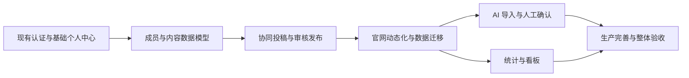

# Lab_web V4–V9 后续开发总体规划与验收基线

- 编写日期：2026-11-06（Asia/Shanghai）。
- 状态：待负责人评审；仅规划，不代表对应实现、测试或部署已经完成。
- 工作位置：`/opt/Lab_web`；开发分支：`arc-update`。不另建临时开发 clone/worktree。
- 输入：负责人提供的《Lab_web 后续开发总体规划大纲》、AGENTS.md、V1–V3 spec、accounts/core 代码、现有导航和认证文档。
- 实施基线：V3 功能提交 `496e005`，工作目录约定提交 `73d851a`；实施前重新读取最新 Git 状态和验收报告。
- 文档关系：本文件规定跨阶段共同契约，V4–V9 六份独立 spec 规定各阶段交付。评审可以逐阶段通过；任何后续版本不得因总体规划通过而自动实施或部署。

## 1. 当前事实与建设目标

当前具备 Django 5.2、DRF、PostgreSQL 16、Gunicorn、Docker Compose、系统 Nginx 和原生 HTML/CSS/JavaScript；后端仅有 accounts/core 业务模块。现有 User 自定义模型包含 role、is_superuser、session_version；已有角色管理、数据库 Session、CSRF、限流、认证审计及健康接口。

V3 注册、登录、个人中心已同步当前目录，支持基础账号信息与密码维护。V3 报告记录 58 项 Django 测试和 20 项浏览器测试通过，这是历史验收数据，本次不冒称重新执行。部分旧文档的“未发布”是历史状态，不能当成当前部署结论。当前未提交 Dockerfile 和未跟踪 README 属于用户改动，必须保留。

官网有新闻、博客、项目、论文、竞赛、出版刊物、成员、成员去向、活动九个导航栏目。现阶段内容仍主要存于 `frontend/data/` 的 HTML 和图片中；没有统一成员数据库、成果关联、审核、AI 或统计模块。

最终形成公开官网、成员个人中心、团队管理后台三个入口，共用 Django API 与 PostgreSQL。一项成果只有一个稳定业务身份，通过参与关系出现在多个公开页面，不能靠复制成果记录实现个人主页。

## 2. 总体技术方案与取舍

采用模块化单体：沿用现有 Django 项目、PostgreSQL 和同源 Session；新增 members、content、workflow、assets、ai_assistant、analytics 模块。原生前端逐页接入，不引入 SPA 构建体系；保留一个系统 Nginx，后端仅 `127.0.0.1:8000`，数据库不映射公网。

比较的方案：

| 方案 | 收益 | 代价与结论 |
| --- | --- | --- |
| 模块化单体、独立类型表、共享版本发布机制 | 与现有部署匹配，事务可保障发布一致性，按栏目切换 | 需要提前定义版本和权限；推荐方案，等待负责人评审 |
| 全部内容塞入一个 JSON 大表 | 初期字段增加快 | 关联完整性、检索、统计和迁移难以维护，不采用 |
| 微服务或全面重写前端 | 服务隔离与复杂交互空间大 | 增加部署、认证和运维成本，本规划不采用 |

这是一份拟议设计，文中的默认值和权限细化属于本次建议，尚不等同于负责人已经批准的业务规则。

## 3. 阶段依赖与交付边界



| 版本 | 必须可独立验收的产物 | 不提前实现 |
| --- | --- | --- |
| V4 | 成员档案、成果分表、可验证关联、版本容器和数据库约束、私有查询 | 完整审核台、公开栏目切换、AI |
| V5 | 申请/认领、协同草稿、审核、发布、归档、管理页面、审计 | 官网批量切换、AI、完整统计 |
| V6 | 公共 API、栏目动态化、成员主页、受控附件、旧资料导入和 URL 兼容 | AI 推断、统计看板 |
| V7 | DeepSeek Flash 文档候选提取、对比确认、限流计费、清理 | 自动授予角色、自动发布、通用聊天代理 |
| V8 | 公私统计口径、看板、受控导出、对账 | 未验证业务预测、复杂 BI 平台 |
| V9 | HTTPS、备份恢复、监控、性能、兼容性与最终运维文档 | 推翻架构、未评审新增业务 |

顺序以 V4→V5→V6→V7→V8→V9 为默认；V8 技术依赖 V6 而非 AI，可在 AI 服务受阻时独立评审实施。每阶段结束冻结接口、迁移和验收报告；下阶段启动前复核上阶段实际实现偏差。按验收门拆任务，不承诺未经测量的工期。

## 4. 三种身份与权限不能混用

1. User 是登录账号，role 决定业务管理权限，ROOT 只由 is_superuser 标识；不修改 V2 的角色枚举，不将 is_staff 当成业务管理员。
2. MemberProfile 是实验室成员档案，允许先有档案后绑定账号；成员类型 TEACHER/STUDENT、在读/在职/毕业/离组是档案属性，不自动提升账号 role。
3. 外部合作者属于 Contributor，不需要账号或伪造为正式成员；与成员档案链接时必须由授权流程确认，禁止凭重名或同邮箱自动绑定。

拟议权限矩阵：

| 操作 | 匿名 | CUSTOMER | 正式成员 STUDENT | TEACHER / ADMIN | ROOT |
| --- | --- | --- | --- | --- | --- |
| 读公开发布内容 | 是 | 是 | 是 | 是 | 是 |
| 维护本人私有档案草稿、提交身份申请 | 否 | 是 | 是 | 是 | 是 |
| 创建科研内容与投稿 | 否 | 否，先通过成员申请 | 是，须绑定有效成员档案 | 是 | 是 |
| 编辑他人内容 | 否 | 否 | 仅显式协作者 | 业务可管理对象且记录审计 | 是 |
| 审核/发布 | 否 | 否 | 否 | 是，不能审核本人本次修改 | 是，同样不能自审 |
| 修改 ADMIN/ROOT 账号或其私密档案 | 否 | 否 | 否 | 否 | 是，仍遵循审计与自审限制 |
| 内部统计与脱敏导出 | 否 | 否 | 仅本人汇总 | 是，排除权限外私密信息 | 是 |

内容发布权不等于账号接管权。ADMIN/TEACHER 可审核包含 ROOT 的科研成果，但不得借审核改 ROOT 账号、绑定或私密资料。公开成员资料的修改审核与私密资料管理分开授权。

所有 API 使用对象级权限、字段白名单；前端隐藏入口只是体验。角色变更、禁用账号后每次请求重新判断；撤销成员资格不删除历史成果，只取消新增投稿能力。绑定成员不自动授权其修改所有关联成果，需获得明确编辑授权或提出纠错申请。

## 5. 权威数据与版本发布共同契约

- 每个业务对象有稳定 UUID；不重建 User 主键。ContentItem 只存通用身份、类型和版本指针，论文等字段在独立的版本明细表，不能所有业务字段放进 ContentItem 或任意 JSON。
- ContentRevision 是不可变提交快照与可编辑草稿容器；每个 revision 必须恰有一种对应类型明细。成员、作者排序、附件、项目关联随版本保存。公共读路径只从 published_revision 出发。
- 同一内容可同时有已发布版本和待审新版。拒绝、撤回和编辑草稿不影响已发布指针；新发布与审计在一笔事务内完成。
- 一项内容最多一个活动草稿/待审版本；乐观锁 lock_version + 审核时数据库行锁避免覆盖和重复批准。已提交版本不可直接编辑。
- 每次写请求拒绝只读字段（creator、reviewer、published_revision、role 等）；创建人、编辑人、审核人由服务器填充。
- 与其他内容的关系以稳定 UUID 建边，但公开显示必须验证目标仍有可公开版本；不得通过关联获取目标草稿/标题。相关成果撤下后从公开关联中去掉。
- MemberProfile 另设 privacy_gate（公开档案、公开联络、教育/去向和资产的即时拒绝开关）；公共读取先通过 gate 再读不可变 published_revision。本人撤销或管理者紧急收紧只改 gate 并清缓存，不改历史快照；重新开放必须新版本审核，审核时还须校验当前本人授权。
- MemberProfile 同样有草稿/已发布资料版本；联系电话、账号邮箱、简历、身份证明永不进入公共 serializer。独立 public_contact_email 可显式选择公开，不能回填账号邮箱。
- 教育经历、研究方向、去向、头像及隐私选择跟随档案版本审核；业务事实只维护一份身份及一组受控版本，不建立彼此独立的“个人页论文副本”。

## 6. 跨阶段必须提前补齐的事项

### 6.1 成员身份申请与管理员页面

V4 建立模型与绑定规则，V5 实现 CUSTOMER 申请、已有档案认领、审批/拒绝、重复绑定防护及后台界面。允许 CUSTOMER 仅创建本人申请材料草稿；通过 STUDENT 申请可由服务器事务授予 STUDENT。申请 TEACHER 不自动获得 TEACHER 管理权，默认先授 STUDENT 投稿权、保留教师档案类型，需 ROOT 显式赋予 TEACHER 角色，或由负责人另行修改权限设计。原因是现有 TEACHER 与 ADMIN 业务管理能力相同，不能把“教师身份验证”等同于全面管理授权。

V5 补上现有用户管理 API 的网页入口；普通管理者仍不能见到或管理 ADMIN/ROOT。V9 才做生产完善并不意味着 V4–V8 可以跳过 CSRF、对象权限、备份或文件安全。

### 6.2 出版刊物、去向和实验室介绍

出版刊物独立 PublicationDetail；成员去向是成员档案版本内 AlumniDestination，不再复制一个“毕业成员账号”。实验室介绍和首页说明采用有限字段的 LabPage 版本内容（限固定键 about/home），不开放任意 HTML 模板或脚本上传。V6 接入原 URL 和栏目。

### 6.3 审计与删除

保留 AuthAuditLog；新增 BusinessAuditLog（目标 UUID、动作、版本、结果、非敏感差异摘要、请求追踪号）。重要写入与成功审计同事务；拒绝也记录必要元数据，禁止记录密码、Cookie、完整简历、API key 和 AI 原始全文。前端不提供修改/删除审计 API。

内容以归档/撤下替代物理删除。撤下后公共详情 404，URL 映射不回退到含旧内容的静态页面。公开隐私撤销立即收紧，不等待普通内容审核；恢复公开必须审核。实际个人数据清理通过服务器命令、保留策略和单独审批，保留必要审计引用或脱敏快照。

## 7. 存储与任务共同设计

V4 预留受控 AssetFile 元数据，V6 实现完整文件访问；V5 只接受受控头像/申请证明需要的最小上传能力，不开放任意附件。文件默认私有，放在 `data/media/private/`，不位于 frontend；公开只读文件在 `data/media/public/`，通过已发布版本与有效权限核验，不以“知道随机 URL”代替权限。

V7 使用 PostgreSQL Job + 独立 Compose worker，共享应用镜像和私有存储，无公网端口；使用行锁领取任务、lease/心跳、超时和有限重试，不在 Gunicorn 请求内长时间解析。初期不引入 Redis/Celery；若实测队列规模不足，先更新 spec 再更换。

## 8. 共用 API 与前端约定

- 路径统一 `/api/`，沿用 `/api/auth/` 和 `/api/admin/users/`；新增 `/api/members/`、`/api/content/`、`/api/review/`、`/api/public/`、`/api/assets/`、`/api/ai/`、`/api/stats/`。
- 所有写请求保持 Cookie + 最新 X-CSRFToken，包括 multipart 上传；登录后重读轮换 token，不跨域放宽、不把会话搬到 localStorage。
- 403 延续现有未认证/无功能权限契约；对象不存在或不可见返回 404，输入 400，版本冲突 409，限流 429，外部服务不可用脱敏 503；异步创建 202。列表统一 count/next/previous/results，默认 20、最大 100，排序稳定。
- 错误包含稳定 code、detail 和 fields；不向客户端返回堆栈、原始上游异常或私密对象存在性。输出文本安全渲染；富文本采用受限 Markdown + 服务端清洗，不直接信任 HTML。
- 个人中心扩展资料、投稿、参与、申请、AI 导入入口；管理后台 `frontend/manage/` 提供用户、成员申请、审核、内容管理，保留原导航及手机布局。可公开下载与内部导出使用不同权限和路由。

## 9. 共用验收命令与证据规则

以下是未来实施时必须执行的命令模板，**本次未执行，不代表通过**。先在当前项目配置专用测试数据库连接，明确名称以 `test_lab_web_` 开头，凭据不输出，不能把测试 runner 指向真实业务库。浏览器测试沿用现有 support.py 隔离模式并扩展，不新建开发仓库。

```bash
cd /opt/Lab_web
git status --short --branch
# V4 先实现测试资源生成器，生成专用 env 与 override；未生成前不可执行。
# override 必须覆盖 image 为 lab-web-backend:test-<SHA>、使用独立数据卷，
# 去掉固定宿主8000端口，仅在需要HTTP时分配随机127.0.0.1端口。
# LAB_TEST_OVERRIDE 是生成文件的绝对路径；env 必须只连接隔离测试库。
docker compose -f docker-compose.yml -f "$LAB_TEST_OVERRIDE" --env-file "$LAB_TEST_ENV" -p lab-web-test config --quiet
docker compose -f docker-compose.yml -f "$LAB_TEST_OVERRIDE" --env-file "$LAB_TEST_ENV" -p lab-web-test build backend
docker compose -f docker-compose.yml -f "$LAB_TEST_OVERRIDE" --env-file "$LAB_TEST_ENV" -p lab-web-test run --rm backend python manage.py check
docker compose -f docker-compose.yml -f "$LAB_TEST_OVERRIDE" --env-file "$LAB_TEST_ENV" -p lab-web-test run --rm backend python manage.py makemigrations --check --dry-run
docker compose -f docker-compose.yml -f "$LAB_TEST_OVERRIDE" --env-file "$LAB_TEST_ENV" -p lab-web-test run --rm backend python manage.py migrate --noinput
docker compose -f docker-compose.yml -f "$LAB_TEST_OVERRIDE" --env-file "$LAB_TEST_ENV" -p lab-web-test run --rm backend python manage.py migrate --check
docker compose -f docker-compose.yml -f "$LAB_TEST_OVERRIDE" --env-file "$LAB_TEST_ENV" -p lab-web-test run --rm backend python manage.py test --noinput --verbosity 2
python -m unittest discover -s tests/browser -p 'test_*.py' -v
python tests/browser/check_cleanup.py
```

注意：现有 Compose 固定宿主端口 8000，单换 `-p` 不能消除端口冲突，也不能自动隔离数据库！V4 测试工具必须拒绝生产镜像标签、外部生产卷和真实库连接，并生成受控 override 去掉/改随机回环端口并隔离卷，检查数据库真实名称和目标主机；先验证隔离，再执行上述模板。不得直接运行默认配置的迁移/测试来验证未发布版本。Browser python 指已安装依赖的测试解释器，不假设系统 Python 已有 Playwright。

每阶段必须记录实际 SHA、依赖/镜像、命令、通过/失败/错误/跳过数量、执行时间、数据库隔离证明、截图或请求结果、未验证事项。新增测试先验证能暴露缺陷，再实现；失败修复后重新跑完整 Django 与浏览器回归，不能删除断言/跳过失败项。旧 V3 测试数量只是基线，后续增加不固定凑数。

## 10. 上线、备份与回退共同门禁

1. 在当前目录只修改批准的阶段；每阶段先检查用户未提交改动、准确 SHA 与镜像标记。不要自动 stash/reset 用户文件。
2. Git 提交和推送 arc-update 不授权 main 合并或部署；当前目录静态文件被 Nginx 直接读取，前端落盘本身会影响页面。前端修改前说明影响，获得该阶段明确发布范围授权；没有授权时先完成可评审补丁文件或服务未引用的新资源，不替换现有被服务读取的页面。
3. 部署前保存 PostgreSQL custom-format 备份、媒体文件和对应清单/校验和、旧镜像及静态版本；备份读取校验不等于恢复演练。数据库与媒体须有一致性窗口/暂停写入方案。
4. 先扩展表/字段、兼容旧代码，再迁移，再切换；不要同一版本删除旧字段或对生产导入试错。迁移批次幂等，可 dry-run，冲突进人工队列。
5. 接口、数据库、容器、公开/私有访问、旧链接和登录回归验证后才宣布部署完成。失败先停后续步骤，再按已审核回退计划处理。
6. 普通应用回退优先退镜像/功能开关、保留兼容新表；不可逆迁移不盲目 reverse。恢复数据库属于可能丢失新写入的灾难操作，必须停写、核算恢复点并由负责人明确批准。禁止 `docker compose down -v`。

## 11. 优先评审的业务决定

下列均给出可实施默认方案，供评审修订，不阻塞本次文档交付：

| 决定 | 本次建议 | 改变时影响 |
| --- | --- | --- |
| CUSTOMER 是否允许直接投稿 | 仅身份申请与本人档案草稿，通过成员审核后投稿 | 反垃圾、审核范围、资源限额 |
| 教师身份是否自动获得管理权 | 不自动；TEACHER 角色由 ROOT 显式授予 | V2 既有权限与身份申请接口 |
| 审核者自己的修改 | 所有人含 ROOT 均禁止自审；至少两名有效审核者 | 小团队需准备第二审核账号，不能后台绕过 |
| 公开联系人 | 独立 public_contact_email 明确勾选并审核 | 隐私与旧资料迁移 |
| AI 文档存留 | 原件默认 7 天、候选 30 天，用户可提前删除 | 存储、排错、隐私策略 |
| 数据恢复目标 | 拟 RPO≤24小时、RTO≤4小时，需实测 | 备份频率、存储与值守成本 |
| AI 经费 | 默认每日 100 次全站/每人 10 次、每日全站 10 元预算，待负责人确认 | 任务排队、额度和实时调用验收 |

## 12. 文件索引与本次验收

- [V4 统一成员资料与科研内容数据库](V4-统一成员资料与科研内容数据库.md)
- [V5 团队协同投稿与审核发布](V5-团队协同投稿与审核发布.md)
- [V6 官网动态化与个人主页自动生成](V6-官网动态化与个人主页自动生成.md)
- [V7 AI文档解析与智能内容填充](V7-AI文档解析与智能内容填充.md)
- [V8 科研成果统计与团队数据看板](V8-科研成果统计与团队数据看板.md)
- [V9 生产环境完善与整体验收](V9-生产环境完善与整体验收.md)

本次仅生成待评审文档并按用户单独授权保存本机 AI 环境配置，不安装依赖、不迁移数据库、不运行 AI、不改 Nginx、不重启容器。本次文档检查见交付说明；阶段功能测试全部未执行/未验证。
