# V5：团队协同投稿与审核发布

- 状态：用户已授权执行；2026-11-06 代码与隔离验收完成，待用户验收及另行批准上线。详见 [验收报告](../docs/V5-验收报告.md)。
- 工作目录 `/opt/Lab_web`，分支 `arc-update`；遵循[总体规划](V4-V9-后续开发总体规划与验收基线.md)。

## 1. 目标与边界

将 V4 的数据容器变成可操作的投稿、审批和发布系统，补齐成员申请与管理端页面。官网仍沿用静态栏目；本阶段证明发布快照切换与权限正确，不提前做 V6 全站数据迁移、V7 AI 或 V8 看板。

复用现有注册、登录、用户管理 API。不得扩大 TEACHER/ADMIN 对 ADMIN、ROOT 的账号/私密档案权限。

## 2. 工作流与并发规则

### 2.1 内容版本状态

```mermaid
stateDiagram-v2
  [*] --> DRAFT
  DRAFT --> SUBMITTED: 作者提交
  SUBMITTED --> APPROVED: 非本次编辑者审核
  SUBMITTED --> REJECTED: 驳回并说明
  SUBMITTED --> WITHDRAWN: 投稿者撤回
  APPROVED --> PUBLISHED: 同事务发布
  REJECTED --> DRAFT: 创建新编号版本
  WITHDRAWN --> DRAFT: 创建新编号版本
```

APPROVED 为审计语义/事务中间态，不留下“已批准但公开指针未更新”的可见半成品。已提交及历史版本不可修改；驳回/撤回后从快照克隆新草稿，保留原记录。每项内容只允许一个活动 working_revision；发布时校验本次提交 base_published_revision，若公开基线已变化返回 409 并要求人工合并，不自动覆盖。

编辑已发布内容创建新草稿；公开读取始终停留旧指针。审核通过时 transaction.atomic + select_for_update 锁定 item 和 revision，重查审核者权限、状态、lock_version、基线和必填字段，再写审计和切指针。两名审核者并发只能一次成功；审计写失败整笔回滚。不能靠前端按钮禁用防并发。

审核者不能是本次提交人或该 revision 的任一内容编辑者；ROOT 也不例外。仅曾编辑旧版本不构成本次自审。小团队如只有一个管理者，必须另设合格审核者；不提供默认自审后门。管理员修正文稿也要创建编辑记录并由他人审阅。

### 2.2 归档、撤下和恢复

撤回仅针对待审版；归档关闭继续投稿，可保持已发布版本公开。撤下使内容公共不可见，记录理由，触发缓存失效；归档与公开可见性不是同一状态。恢复归档后可继续编辑，恢复已撤下公开内容必须重新审核；恢复不能把旧草稿直接公开。创建者无权物理删除已发布内容。

同一 API 不能同时以 DELETE 表示“删草稿/撤下/归档”。草稿放弃保留审计，物理清理由运维保留策略处理。

### 2.3 成员关联确认与纠错

关联确认派生状态：UNCONFIRMED/CONFIRMED/DISPUTED。提交后的关系字段和署名快照不可变；ContributionConfirmation 追加记录绑定 revision/contribution、确认者、动作、代确认理由及时间，最新有效记录决定展示状态，不覆盖快照。同一 revision 的争议可在审核前产生，发布事务重查；发布后的争议走纠错/紧急撤下，不修改历史批准记录。新草稿默认重新确认；只有贡献者ID、署名、单位、排序、职责及对应作者标记完全不变，服务才允许引用上一版本确认并记录继承来源，任何一项变化必须重新确认。录入不向成员自动授予编辑权；绑定有效账号的新增关联需本人确认，或审核者记录“证据核验代确认”理由。外部作者无账号时由审核者核对证据。存在 DISPUTED 的关联阻止发布；成员提出纠错生成 CorrectionRequest，不直接改公开作者表。

已经公开的错误署名，通过新版本审核纠正；隐私泄露可由管理者先紧急撤下并审计。删除关联不能删除成员账号或其他成果。

### 2.4 身份申请

CUSTOMER 可提交本人身份申请/认领已有未绑定档案，提交时以现有认证身份填 applicant。管理员不能仅凭同名自动绑定，需人工核验证明；不强制收集身份证等过量材料。审批需锁定 User/Profile/Application，防止重复绑定与重复审批。

若申请者已有 V4 自动建立的 PENDING 临时档案，而目标是已有未绑定档案，审批事务锁定 User、两份 Profile、Application：只允许临时档案尚无已发布版本、成果/Contributor关联和活动稿件时合并。保留申请证据与临时草稿为迁移历史，草稿字段以差异预览供本人/审核者选择，不覆盖目标已发布资料；解除临时绑定、将正式档案绑定账号、将临时档案标记 merged_into 且只读。若临时档案已有成果或 Contributor，返回冲突，交由专门人工合并服务处理，不自动转移作者或删除记录。并发认领受账号唯一和目标绑定约束保护。通过后绑定正式档案、设置 ACTIVE，并向 CUSTOMER 授 STUDENT 投稿权限；教师档案类型不自动授 TEACHER 管理权限。ROOT 可另走现有角色管理接口显式授权；已有 ADMIN/ROOT 不允许普通管理者通过认领流程修改其绑定。拒绝/撤回只改变申请，不改变账号权限；禁用者不能申请或审批。

成员公开资料版本采用同内容相同的不可变提交/审批策略；撤销公开通过 MemberProfile.privacy_gate 即时收紧，public selectors/下载/缓存统一判断，历史快照不改。恢复公开须本人重新授权及他人审核的新版本，不能单独PATCH gate恢复。私密本人联系方式修改不自动公开；隐私撤销即时收紧，新增公开字段需审核。

## 3. 数据与服务

新增 ContentEditGrant（item/user、授予者、读写范围、时间、撤销时间）、ReviewDecision（revision、reviewer、动作、理由）、RevisionEditEvent（revision/editor）、CorrectionRequest、ContributionConfirmation；沿用 BusinessAuditLog，新增状态索引和唯一活动稿约束。成员版本与内容版本有各自具体外键，不接受任意模型名。

EditGrant 默认仅对象创建者可编辑；管理者可按业务范围管理但不能自审；参与者只能看其关联的公开成果、待确认的必要署名摘要，不因此能读完整私有草稿。转交/授权需要显式服务审计；密码/账号权限永不进入稿件字段。

接口输入必填标题、对应类型字段、关联排序；理由长度 1–2000；对过长正文、未知字段、非法状态与被撤销权限返回稳定错误。审核事务需要保持短，不在其中请求外部服务或生成文件。

## 4. API 契约

| 方法/路径 | 功能 | 权限/冲突 |
| --- | --- | --- |
| GET/POST `/api/content/items/` | 我可见列表/创建草稿（kind+payload） | 正式成员或管理者；CUSTOMER 403 |
| GET `/api/content/items/{uuid}/` | 私有对象概览与版本信息 | 创建者/获授权者/合格管理者 |
| POST `/api/content/items/{uuid}/revisions/` | 基于发布/历史版本建草稿 | 校验基线；已有活动稿 409 |
| PATCH `/api/content/revisions/{uuid}/` | 编辑 DRAFT，需 lock_version | 只允许类型字段与关联/附件 |
| POST `/api/content/revisions/{uuid}/submit/` | 提交不可变快照 | 必填校验、确认检查 |
| POST `/api/content/revisions/{uuid}/withdraw/` | 撤回本人的待审稿 | 已审核/重复请求 409 |
| GET `/api/review/tasks/` | 分页、类型/状态筛选 | 审核者可见，标示不可自审 |
| POST `/api/review/revisions/{uuid}/decision/` | APPROVE/REJECT + reason + lock_version | 审核与发布同事务；自审 403 |
| POST `/api/content/items/{uuid}/archive/`、`unarchive/`、`unpublish/` | 独立动作 | 管理者；需理由/审计 |
| POST `/api/content/items/{uuid}/grants/` | 新增/撤销协作授权 | 创建者/管理者，不能跨权限授权 |
| POST `/api/content/contributions/{uuid}/confirm/` | 确认或争议 | 仅绑定的本人；不能伪造别人 |
| POST `/api/content/items/{uuid}/corrections/` | 申请纠错 | 本人参与者/成员，限流 |
| GET/POST `/api/members/applications/` | 我的申请/提交 | 已登录本人，唯一活动申请 |
| POST `/api/review/member-applications/{uuid}/decision/` | 成员身份审批 | 管理者、目标对象权限、禁自审 |
| POST `/api/members/me/privacy/restrict/` | 本人即时收紧指定公开字段/资料；只允许收紧，清缓存并审计 | 不能恢复公开或修改历史快照 |
| POST `/api/members/me/draft/submit/` | 本人公开档案变更提交 | 不直接发布 |
| GET `/api/content/items/{uuid}/history/` | 版本/审核历史 | 对象可见范围，公众不开放 |

成员资料的审核使用 `/api/review/member-revisions/{uuid}/decision/`，不伪装为 content revision。decision、submit 等重复写请求按状态返回 409，不重复创建审计成功记录或重复发通知。列表仅允许白名单筛选，不接受任意 ORM 字段/关联路径。

写请求示例：`{"decision":"REJECT","reason":"请核对作者顺序","lock_version":4}`。成功返回新状态/新 lock_version；身份取 Session，reviewer 不可写。

## 5. 前端与文件清单

新增 `frontend/workspace.html`（我的草稿/投稿/参与）、`content-editor.html`、`member-application.html`、`frontend/manage/index.html`、users.html、members.html、reviews.html、content.html；新增 `js/content-api.js`、content-editor.js、review.js、member-profile.js 及对应 scoped CSS。管理页面入口按后端能力展示，直接访问页面也不能绕过 API。

修改 `frontend/profile.html`、`js/auth.js` 的有限扩展入口，复用最新 CSRF 获取逻辑，不破坏密码/退出和跨标签会话失效处理。新增接口帮助函数不得重新实现一套不一致的 Session 缓存。编辑器显示保存、提交、冲突、审核意见及版本差异；遇 409 保留草稿并提示刷新合并，禁止无提示覆盖。

V5 同步实现最小资产上传，不能等待 V6：`POST /api/assets/` 仅允许本人头像JPEG/PNG/WebP≤5MiB、申请证明PDF≤10MiB，multipart parser与JSON并存，验证MIME/魔数/大小/解码、安全随机路径，全部先存私有区。`GET /api/assets/{uuid}/download/` 仅本人或有权处理该申请的审核者可读，证明不公开；历史申请被拒/到期按策略清理，不公开裸 storage_key。头像须通过版本审核且privacy_gate允许才作公共图片。V6 扩展DOCX/通用内容附件与完整迁移。文件检测失败保留隔离，不接受客户端自报“已扫描”。

后端修改 members/content/workflow 的 services、selectors、permissions、views/urls、迁移；新增 `docs/content-api.md`、workflow.md、`docs/V5-验收报告.md`、对应 Django/浏览器测试。用户管理页面调用既有 API，不新增第二套提权逻辑。

## 6. 实施任务与实际验收要求

1. 写工作流/对象权限/自审/并发失败测试，再实现状态服务。
2. 实现成员申请、认领及审批测试，再实现权限安全的前端。
3. 实现内容编辑、关联确认、纠错、审核与历史 API；接口测试先行。
4. 实现成员工作区、审核台、用户管理与手机布局。
5. 执行总体规划完整命令及 `python manage.py test apps.workflow apps.content apps.members --verbosity 2`，再跑真实浏览器新增场景和 V3 全部回归。

强制验收：草稿→提交→驳回→新稿→再次提交→他人审核发布；已发布 A 待审 B 时公开选择器始终返回 A，批准后一次切换 B；并发编辑返回 409；并发批准只成功一次；自审 ROOT/ADMIN/TEACHER 都被拒；审计故障不改变发布指针；撤回不撤下旧版；归档/撤下/恢复严格区分；成员争议阻止发布；权限撤销及时生效；申请不能升 ADMIN/TEACHER/ROOT；禁用用户旧 Session 无权操作；缺失/错误 CSRF 拒写；私密对象不可枚举；最小文件上传CSRF/跨用户下载/超限/伪装文件被拒，私密证明无公网直链；所有密码/Token 不出现在响应或审计。

本阶段公共官网尚未切换，用后端公共选择器和受控预览证明旧版本隔离；V6 再做真实公共页同步验收，不能提前宣称官网动态化完成。浏览器至少覆盖 1440/390/320 宽度、键盘操作、错误关联与登录过期。

## 7. 风险与回退

审核规则复杂，先固定状态转换表，禁止 views 中散落直接修改状态。关联确认可能造成投稿积压，管理员可证据代确认但必须理由和审计，不能静默绕过。通知先做站内任务状态，不以邮件发送成功作为事务完成条件。

发布前备份 DB 和已上传证明文件。回退关闭新入口、恢复兼容镜像，保留版本/审计/绑定数据；不通过批量重置角色回退身份审批。若错误授予权限，按既有管理服务纠正并失效 Session，记录审计。交付状态机、权限表、完整实际测试数量、API 示例和部署/回退手册；未通过测试不得宣布 V5 完成。

## 实施澄清

独立用户角色管理保留用户明确要求的 V2 规则：ADMIN/TEACHER 可管理 CUSTOMER/STUDENT/TEACHER，不能接管 ADMIN/ROOT。身份审批自身只向 CUSTOMER 授 STUDENT，不自动授 TEACHER。总体规划中 ROOT 单独授 TEACHER 的建议不改变既有获授权的 V2 API。V5 文件检测采用限资源解析与清洗，失败文件不进入可用资产库；不宣称完整病毒扫描，公共头像服务留至 V6。
